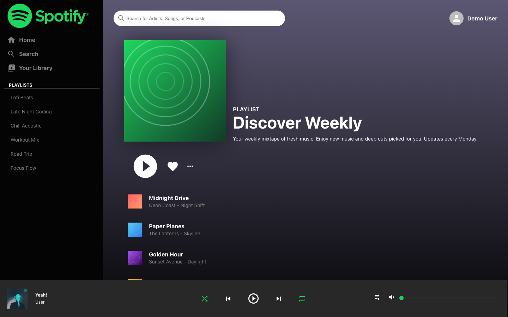
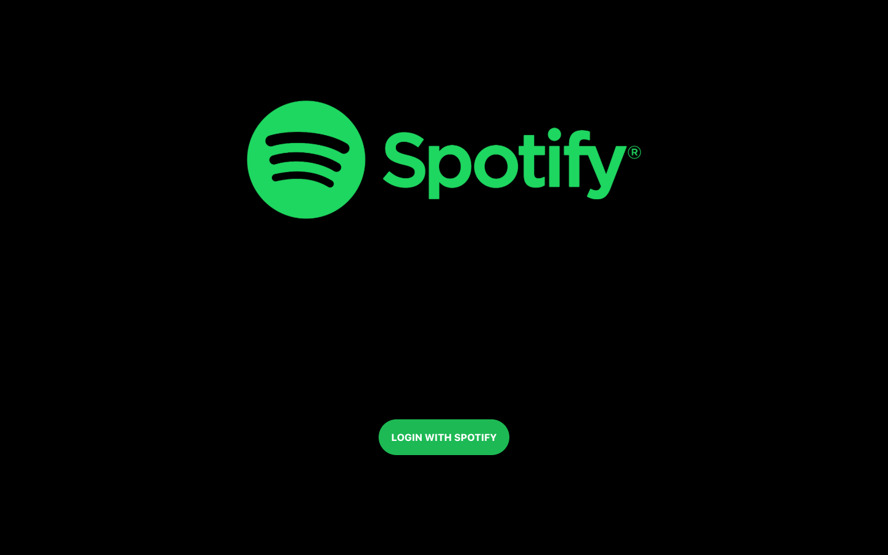

<div align="center">

# Spotify Clone

A Spotify web player clone built with React and the Spotify Web API.

  

</div>

<table>
  <tr><th>Player</th></tr>
  <tr><td></td></tr>
</table>

## About

A recreation of the Spotify web player interface. After you log in with your Spotify account, the app loads your profile, your playlists and your Discover Weekly playlist from the Spotify Web API, and shows them in Spotify's familiar layout: a sidebar of playlists, a playlist view with its tracks, and a player bar.

## Screenshots

<table>
  <tr><th>Login</th></tr>
  <tr><td></td></tr>
</table>

<sub>Screenshots use demo playlist data and generated cover art.</sub>

## Features

- **Spotify login** using the OAuth implicit grant flow
- **Sidebar** with navigation and all of your playlists
- **Playlist view**: cover, title, description and a track list with album art
- **Header** with a search bar and your Spotify profile
- **Player bar** with shuffle, previous, play, next, repeat and volume controls
- Global state with the React Context API and a reducer

## Tech Stack

| Area | Technology |
| --- | --- |
| UI | React 16 (Create React App) |
| State | React Context API + `useReducer` |
| Icons and controls | Material UI |
| API | Spotify Web API via [spotify-web-api-js](https://github.com/JMPerez/spotify-web-api-js) |

## Getting Started

**Prerequisites:** Node.js and a Spotify account

1. Create an app in the [Spotify Developer Dashboard](https://developer.spotify.com/dashboard) and add `http://localhost:3000/` as a redirect URI.
2. Put your app's client ID in `spotify-clone-app/src/spotify.js`.
3. Install and start the app:

   ```bash
   cd spotify-clone-app
   npm install
   npm start
   ```

Then open [http://localhost:3000](http://localhost:3000) and log in with Spotify. On Node.js 17 or later, run `export NODE_OPTIONS=--openssl-legacy-provider` first, because this project uses `react-scripts` 3.

## Project Structure

```
.
├── spotify-clone-app/
│   ├── public/            # index.html and the Spotify logo
│   └── src/
│       ├── App.js         # login handling and data loading
│       ├── spotify.js     # Spotify auth URL and token parsing
│       ├── DataLayer.js   # React context provider
│       ├── reducer.js     # app state
│       └── *.js / *.css   # Login, Player, Sidebar, Body, Header, Footer, SongRow
└── screenshots/           # images used in this README
```
